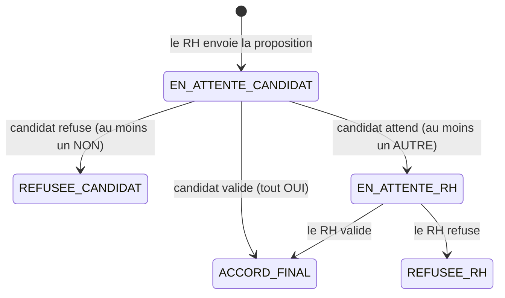

# Formulaire d'acceptation de la proposition d'embauche

Documentation du code et de son fonctionnement.
Projet : processus RH (base PostgreSQL `grh`), Spring Boot 3 / JPA / Thymeleaf / Lombok.

---

> **Partie 1 (§1 à §10)** : fonctionnement général. **Partie 2 (§11 à §12)** : explication ligne par ligne de chaque fichier de code.

## 1. Objectif

Après l'entretien, le RH délivre une **proposition d'embauche** au candidat retenu. Le candidat remplit un **formulaire d'acceptation** :

- les champs sont **pré-remplis** avec ce que le RH a décidé lors du besoin (validé par le financier et le DG) ;
- pour chaque critère, le candidat répond **Oui**, **Non** ou **Autre** ;
- trois boutons : **Valider**, **Attendre**, **Refuser** ;
- si le candidat choisit **Autre**, un champ s'affiche pour saisir sa proposition ; seul **Attendre** est alors disponible ;
- cette contre-proposition est envoyée au RH, qui la **valide ou la refuse** et **notifie toujours le candidat** ;
- ensuite, le candidat peut continuer son recrutement (choix du contrat, hors périmètre de cette tâche).

---

## 2. Déroulement général

1. Le RH crée une `proposition_embauche` pour une candidature retenue (statut `EN_ATTENTE_CANDIDAT`).
2. Le candidat ouvre son formulaire : `/candidats/{idCandidat}/propositions/{idProposition}`.
3. Le formulaire affiche les cinq critères avec les valeurs décidées lors du besoin.
4. Le candidat répond à chaque critère puis clique sur un bouton.
5. Le serveur vérifie les règles, enregistre la réponse, change le statut et notifie le RH.
6. Si le candidat a cliqué sur **Attendre**, le RH ouvre `/rh/propositions/{idProposition}`, examine la contre-proposition et clique sur **Valider** ou **Refuser**.
7. Le serveur enregistre la décision et notifie le candidat.

---

## 3. Règles métier

### 3.1 Les cinq critères

| Code | Libellé affiché | Valeur pré-remplie vient de |
|---|---|---|
| `SALAIRE` | Salaire mensuel | `besoin_poste.salaire_valide_finance` (à défaut `salaire_propose_rh`) |
| `HORAIRE` | Horaire de travail | `besoin_poste.horaire_travail` |
| `RESPONSABLE` | Responsable hiérarchique | `besoin_poste.responsable_hierarchique` |
| `TRAVAIL` | Travail à effectuer | `besoin_poste.missions` |
| `DATE_PRISE_POSTE` | Date de prise de poste | `besoin_poste.date_prise_poste` |

### 3.2 Réponses et boutons

| Réponses du candidat | Bouton actif | Nouveau statut | Réponse globale |
|---|---|---|---|
| Tous `OUI` | **Valider** | `ACCORD_FINAL` | `OUI` |
| Au moins un `NON`, aucun `AUTRE` | **Refuser** | `REFUSEE_CANDIDAT` | `NON` |
| Au moins un `AUTRE` | **Attendre** | `EN_ATTENTE_RH` | `AUTRE` |

Le bouton **Attendre** a la priorité : dès qu'un critère est sur `AUTRE`, **Valider** et **Refuser** sont désactivés, même s'il y a aussi des `NON`.

### 3.3 Salaire

- **Valider** : `salaire_final` = salaire décidé lors du besoin.
- **Attendre** avec le critère salaire sur `AUTRE` : le montant saisi est enregistré dans `salaire_demande`.
- **Le RH valide** : `salaire_final` = `salaire_demande` si le candidat en a proposé un, sinon le salaire décidé lors du besoin.
- **Le RH refuse** : `salaire_final` reste vide.

### 3.4 Décision du RH

| Décision | Statut | `decision_rh` | Message envoyé au candidat |
|---|---|---|---|
| Valider | `ACCORD_FINAL` | `ACCEPTEE` | « Le service RH a accepté votre contre-proposition. Vous pouvez poursuivre votre recrutement. » |
| Refuser | `REFUSEE_RH` | `REFUSEE` | « Le service RH a refusé votre contre-proposition. » |

Si le RH écrit un commentaire, il est ajouté au message.

---

## 4. Cycle de vie du statut de la proposition



`ACCORD_FINAL`, `REFUSEE_CANDIDAT` et `REFUSEE_RH` sont des statuts finaux : la proposition ne peut plus être modifiée.

---

## 5. Base de données

### 5.1 Tables lues seulement

Le formulaire **lit** ces tables sans les modifier, avec une requête SQL (pas de modèle Java dédié) :

- `candidat` : nom et prénom ;
- `candidature` : lien entre le candidat et l'offre ;
- `offre_emploi` : titre de l'offre ;
- `besoin_poste` : salaire et conditions décidés par le RH ;
- `besoin` : `id_rh_traitant`, pour savoir à quel RH envoyer les notifications.

La chaîne de jointures est : `proposition_embauche → candidature → offre_emploi → besoin_poste → besoin`. C'est le poste choisi par le candidat (via son offre) qui désigne la bonne ligne de `besoin_poste`.

### 5.2 Tables où le code écrit

| Table | Contenu |
|---|---|
| `proposition_embauche` | date d'envoi, réponse du candidat, contre-proposition, `salaire_demande`, décision du RH, `salaire_final`, statut |
| `critere_proposition` | une ligne par critère et par proposition : réponse (`OUI`/`NON`/`AUTRE`), texte de la contre-proposition, date de réponse |
| `notification` | messages destinés au candidat **ou** au RH (un seul destinataire par ligne, contrainte `CHECK`) |

### 5.3 Tables de libellés

`statut_proposition`, `reponse_candidat`, `decision_rh`, `type_critere_proposition` et `reponse_critere` contiennent les valeurs fixes (`EN_ATTENTE_CANDIDAT`, `OUI`, `ACCEPTEE`, `SALAIRE`, etc.). Le code les retrouve par leur `libelle`.

---

## 6. Architecture du code

Package de base : à adapter à ton projet (par exemple `mg.grh.recrutement`). Il doit être **sous** le package de la classe `@SpringBootApplication`.

```
recrutement
├── model        entités JPA (tables dans lesquelles on lit/écrit)
├── repository   accès à la base (Spring Data) + projection PropositionInfo
├── dto          objets échangés entre service, contrôleur et vue
├── service      règles métier (PropositionService)
└── controller   routes HTTP (candidat, RH, notifications)

templates/proposition
├── formulaire.html      formulaire du candidat
├── rh-decision.html     page de décision du RH
└── notifications.html   liste des messages
```

Principe : **contrôleur → service → repository → base**. Le contrôleur ne contient aucune règle métier ; toutes les règles sont dans `PropositionService`.

---

## 7. Détail des couches

### 7.1 Modèles (`model`)

| Classe | Table | Rôle |
|---|---|---|
| `PropositionEmbauche` | `proposition_embauche` | la proposition et son suivi |
| `CritereProposition` | `critere_proposition` | la réponse à un critère |
| `Notification` | `notification` | un message (méthode `pour(...)` pour créer une notification) |
| `StatutProposition`, `ReponseCandidat`, `DecisionRh`, `TypeCritereProposition`, `ReponseCritere` | tables de libellés | valeurs fixes, lues par `libelle` |

### 7.2 Repositories (`repository`)

- Les repositories de libellés exposent `findByLibelle(...)`.
- `CritereRepository.findByPropositionIdOrderByTypeIdAsc(...)` renvoie les critères d'une proposition dans l'ordre.
- `NotificationRepository` liste les notifications d'un candidat ou d'un responsable, de la plus récente à la plus ancienne.
- `PropositionEmbaucheRepository.findInfo(id)` est une **requête SQL native** qui renvoie, en une fois, une `PropositionInfo` : identité du candidat, titre de l'offre, `id_rh_traitant`, salaire (`COALESCE(salaire_valide_finance, salaire_propose_rh)`), horaire, responsable, missions et date de prise de poste (déjà formatée `jj/mm/aaaa`).

Les alias de la requête sont entre guillemets (`"idProposition"`) car PostgreSQL passe sinon les noms en minuscules et la projection renverrait `null`.

### 7.3 DTO (`dto`)

- `ReponseForm` : ce que le formulaire envoie (`action`, `reponse[CODE]`, `contre[CODE]`).
- `CritereLigne` : une ligne affichée (code, libellé, valeur pré-remplie, réponse, contre-proposition).
- `FormulaireVue` : tout ce dont la page a besoin (candidat, offre, statut, indicateurs `modifiable` et `attenteRh`, liste des lignes).

### 7.4 Service (`PropositionService`)

| Méthode | Rôle |
|---|---|
| `vueCandidat` | construit le formulaire du candidat après avoir vérifié que la proposition lui appartient |
| `vueRh` | construit la page de décision du RH |
| `soumettre` | traite la réponse du candidat (voir ci-dessous) |
| `decider` | enregistre la décision du RH et notifie le candidat |

**`soumettre`, étape par étape :**

1. récupère les infos et vérifie que la proposition appartient au candidat ;
2. refuse si le statut n'est pas `EN_ATTENTE_CANDIDAT` ;
3. pour chaque critère : vérifie que la réponse est `OUI`, `NON` ou `AUTRE`, et, si `AUTRE`, exige un texte (pour le salaire, un nombre positif) ;
4. mémorise s'il y a au moins un `AUTRE` et au moins un `NON` ;
5. selon le bouton (`VALIDER`, `REFUSER`, `ATTENDRE`), contrôle que les réponses sont compatibles avec l'action (règles du §3.2), met à jour la proposition, le salaire et le statut ;
6. notifie le RH.

La méthode est `@Transactional` : si une règle échoue (`RegleMetierException`), **rien n'est enregistré**.

**Méthodes internes utiles :**

- `assurerCriteres` crée les cinq lignes de `critere_proposition` si elles n'existent pas encore ;
- `valeurProposee` choisit la valeur pré-remplie selon le code du critère ;
- `salaireInitial` renvoie le salaire décidé lors du besoin, ou une erreur s'il n'y en a pas ;
- `lireMontant` convertit le texte saisi en nombre entier positif ;
- `notifierRh` / `notifierCandidat` créent les notifications.

### 7.5 Contrôleurs (`controller`)

| Route | Rôle |
|---|---|
| `GET /candidats/{idCandidat}/propositions/{idProposition}` | affiche le formulaire |
| `POST /candidats/{idCandidat}/propositions/{idProposition}` | enregistre la réponse |
| `GET /rh/propositions/{idProposition}` | affiche la réponse du candidat au RH |
| `POST /rh/propositions/{idProposition}/decision` | le RH valide ou refuse (`decision=VALIDER` ou `REFUSER`, `commentaire` facultatif) |
| `GET /candidats/{id}/notifications` | messages du candidat |
| `GET /rh/{id}/notifications` | messages du RH |

Après un POST, le contrôleur **redirige** vers la page (modèle « Post/Redirect/Get ») et affiche le message de succès ou d'erreur via des attributs flash.

### 7.6 Vues et JavaScript

**`formulaire.html`** affiche, pour chaque critère, la valeur du RH, trois boutons radio et un champ de saisie caché.

Le JavaScript (`majEtat`) se relance à chaque changement et :

- affiche le champ de saisie seulement quand `AUTRE` est choisi, et le rend obligatoire ;
- active **Valider** si tout est `OUI` ;
- active **Refuser** s'il y a un `NON` et aucun `AUTRE` ;
- active **Attendre** s'il y a un `AUTRE` avec sa proposition remplie ;
- laisse tous les boutons désactivés tant qu'un critère n'a pas de réponse.

Quand la proposition n'est plus modifiable, les boutons radio sont désactivés et les boutons d'action disparaissent.

**`rh-decision.html`** affiche un tableau (critère, proposition du RH, réponse, contre-proposition) et, si la proposition est en attente du RH, un champ de message et les boutons **Valider** / **Refuser**.

**`notifications.html`** liste les messages avec un lien vers la proposition concernée.

---

## 8. Sécurité et validations

- **Double validation** : le JavaScript guide l'utilisateur, mais le serveur revérifie tout (réponses valides, action compatible, montant positif). Un appel HTTP forgé ne peut pas contourner les règles.
- **Appartenance** : un candidat ne peut ouvrir ou répondre qu'à **sa** proposition (sinon erreur 404).
- **Réponse unique** : une proposition qui n'est plus `EN_ATTENTE_CANDIDAT` ne peut pas être modifiée une seconde fois.
- **Transaction** : tout ou rien.

---

## 9. Tester

Avec les données de test : candidat Hery Rabe (id 1), proposition (id 1), RH (id 6).

1. `http://localhost:8080/candidats/1/propositions/1` : le formulaire s'affiche avec les valeurs de `besoin_poste`.
2. Teste les trois cas : tout `Oui` (Valider), un `Non` (Refuser), un `Autre` (Attendre).
3. Après **Attendre** : `http://localhost:8080/rh/6/notifications`, puis « Examiner la réponse », puis Valider ou Refuser.
4. `http://localhost:8080/candidats/1/notifications` : le message du RH apparaît.

Remise à zéro pour rejouer un test (test uniquement) :

```sql
UPDATE proposition_embauche
SET id_statut_proposition = (SELECT id_statut_proposition FROM statut_proposition WHERE libelle = 'EN_ATTENTE_CANDIDAT'),
    id_reponse_candidat = NULL, contre_proposition = NULL, salaire_demande = NULL,
    date_reponse_candidat = NULL, id_decision_rh = NULL, commentaire_rh = NULL,
    date_decision_rh = NULL, salaire_final = NULL
WHERE id_proposition = 1;

UPDATE critere_proposition
SET id_reponse_critere = NULL, contre_proposition = NULL, date_reponse = NULL
WHERE id_proposition = 1;

DELETE FROM notification WHERE id_proposition = 1;
```

---

## 10. Limites et pistes d'amélioration

- **Pas d'authentification** : le candidat est identifié par l'URL. À remplacer par l'identité de la session quand le module Authentification sera branché.
- **Après un refus du RH** (`REFUSEE_RH`), le statut est final. Si le candidat doit pouvoir revenir à la proposition initiale, seule la méthode `decider` est à modifier.
- **Date de prise de poste** : elle vient de `besoin_poste`, donc elle est identique pour tous les candidats d'un même poste.
- **Salaire** : le salaire affiché est `salaire_valide_finance`, à défaut `salaire_propose_rh`.
- **Notifications** : pas encore de bouton « marquer comme lu » (la colonne `lu` existe déjà).
- **Notification au RH** : elle dépend de `besoin.id_rh_traitant` ; s'il est vide, aucune notification n'est créée pour le RH.


---

# Partie 2 : explication ligne par ligne du code

## 11. Comment lire cette partie

Chaque fichier est présenté avec son code, suivi de l'explication des lignes. Quand plusieurs classes sont identiques (les petites tables de libellés), j'explique la première en détail et je donne seulement les différences pour les autres. Les lignes de style CSS ne sont pas recopiées : elles ne changent que l'apparence (voir le §11.8).

### 11.0 Les annotations qui reviennent partout

| Annotation | Rôle |
|---|---|
| `@Entity` | cette classe représente une table de la base |
| `@Table(name = "...")` | nom exact de la table |
| `@Id` | ce champ est la clé primaire |
| `@GeneratedValue(strategy = GenerationType.IDENTITY)` | la base génère l'identifiant (colonne `SERIAL`) |
| `@Column(name = "...")` | lie le champ Java à la colonne SQL du même sens |
| `@ManyToOne` | clé étrangère vers une autre table |
| `@JoinColumn(name = "...")` | nom de la colonne qui porte la clé étrangère |
| `optional = false` | la clé étrangère est obligatoire (`NOT NULL`) |
| `@Getter` / `@Setter` (Lombok) | génèrent automatiquement `getXxx()` et `setXxx()` |
| `@Service` | classe de règles métier gérée par Spring |
| `@RequiredArgsConstructor` (Lombok) | génère le constructeur qui reçoit tous les champs `final` ; Spring y injecte les repositories |
| `@Transactional` | tout ce que fait la méthode est enregistré ensemble, ou annulé en cas d'erreur |
| `@Controller` | classe qui répond aux requêtes HTTP et renvoie une page |
| `@RequestMapping`, `@GetMapping`, `@PostMapping` | route (URL) gérée par la classe ou la méthode |
| `@PathVariable` | valeur prise dans l'URL (`{idCandidat}`) |
| `@ModelAttribute` | remplit un objet avec les champs du formulaire |
| `@RequestParam` | valeur d'un champ de formulaire ou d'un paramètre |

---

## 11.1 Modèles (`model`)

### StatutProposition.java (modèle de libellé)

```java
package com.grh.recrutement.model;

import jakarta.persistence.*;
import lombok.Getter;
import lombok.Setter;

@Entity
@Table(name = "statut_proposition")
@Getter @Setter
public class StatutProposition {
    @Id @GeneratedValue(strategy = GenerationType.IDENTITY)
    @Column(name = "id_statut_proposition")
    private Integer id;
    private String libelle;
}
```

| Ligne | Explication |
|---|---|
| `package ...model;` | dossier logique de la classe ; il doit correspondre au dossier réel sur le disque |
| `import jakarta.persistence.*;` | importe toutes les annotations JPA (`@Entity`, `@Id`, ...) |
| `import lombok.Getter; import lombok.Setter;` | importe les annotations Lombok qui génèrent les accesseurs |
| `@Entity` | Spring/JPA sait que cette classe correspond à une table |
| `@Table(name = "statut_proposition")` | la table s'appelle `statut_proposition` |
| `@Getter @Setter` | pas besoin d'écrire les getters et setters à la main |
| `public class StatutProposition {` | une ligne de la table = un objet de cette classe |
| `@Id @GeneratedValue(...)` | le champ suivant est la clé primaire, générée par la base |
| `@Column(name = "id_statut_proposition")` | le champ `id` correspond à la colonne `id_statut_proposition` |
| `private Integer id;` | l'identifiant (`Integer` et non `int` pour pouvoir valoir `null` avant l'enregistrement) |
| `private String libelle;` | colonne `libelle` ; pas de `@Column` car le nom est identique |

**Les quatre autres modèles de libellé suivent exactement le même modèle**, avec seulement ces différences :

| Classe | Table | Colonne de l'id |
|---|---|---|
| `ReponseCandidat` | `reponse_candidat` | `id_reponse_candidat` |
| `DecisionRh` | `decision_rh` | `id_decision_rh` |
| `TypeCritereProposition` | `type_critere_proposition` | `id_type_critere` |
| `ReponseCritere` | `reponse_critere` | `id_reponse_critere` |

### PropositionEmbauche.java

```java
package com.grh.recrutement.model;

import jakarta.persistence.*;
import lombok.Getter;
import lombok.Setter;

import java.math.BigDecimal;
import java.time.LocalDateTime;

@Entity
@Table(name = "proposition_embauche")
@Getter @Setter
public class PropositionEmbauche {

    @Id @GeneratedValue(strategy = GenerationType.IDENTITY)
    @Column(name = "id_proposition")
    private Integer id;

    @Column(name = "id_candidature")
    private Integer idCandidature;

    @Column(name = "date_envoi")
    private LocalDateTime dateEnvoi;

    @ManyToOne
    @JoinColumn(name = "id_reponse_candidat")
    private ReponseCandidat reponseCandidat;

    @Column(name = "commentaire_candidat")
    private String commentaireCandidat;

    @Column(name = "contre_proposition")
    private String contreProposition;

    @Column(name = "salaire_demande")
    private BigDecimal salaireDemande;

    @Column(name = "date_reponse_candidat")
    private LocalDateTime dateReponseCandidat;

    @ManyToOne
    @JoinColumn(name = "id_decision_rh")
    private DecisionRh decisionRh;

    @Column(name = "commentaire_rh")
    private String commentaireRh;

    @Column(name = "date_decision_rh")
    private LocalDateTime dateDecisionRh;

    @Column(name = "salaire_final")
    private BigDecimal salaireFinal;

    @ManyToOne(optional = false)
    @JoinColumn(name = "id_statut_proposition")
    private StatutProposition statut;
}
```

| Ligne | Explication |
|---|---|
| `import java.math.BigDecimal;` | type pour les montants : il évite les erreurs d'arrondi des `double` |
| `import java.time.LocalDateTime;` | type pour les dates avec heure (`TIMESTAMP`) |
| `id` | clé primaire `id_proposition` |
| `idCandidature` | numéro de la candidature concernée ; simple entier, car on n'a pas besoin de l'objet `Candidature` complet |
| `dateEnvoi` | date d'envoi de la proposition au candidat |
| `reponseCandidat` | réponse globale du candidat (`OUI`, `NON` ou `AUTRE`), clé étrangère vers `reponse_candidat` ; peut être vide tant qu'il n'a pas répondu |
| `commentaireCandidat` | commentaire libre du candidat (colonne disponible, non utilisée par le formulaire actuel) |
| `contreProposition` | résumé de ce que le candidat propose (une ligne par critère « Autre ») |
| `salaireDemande` | salaire proposé par le candidat, rempli seulement s'il met « Autre » sur le salaire |
| `dateReponseCandidat` | moment où le candidat a répondu |
| `decisionRh` | décision du RH sur la contre-proposition (`ACCEPTEE` ou `REFUSEE`) |
| `commentaireRh` | message écrit par le RH |
| `dateDecisionRh` | moment de la décision du RH |
| `salaireFinal` | salaire finalement retenu |
| `statut` | statut de la proposition ; `optional = false` car la colonne est `NOT NULL` |

Il n'y a plus de champ `salairePropose`, `horaireTravail`, etc. : ces informations viennent maintenant de `besoin_poste` (voir §5.1).

### CritereProposition.java

```java
@Entity
@Table(name = "critere_proposition")
@Getter @Setter
public class CritereProposition {

    @Id @GeneratedValue(strategy = GenerationType.IDENTITY)
    @Column(name = "id_critere_proposition")
    private Integer id;

    @ManyToOne(optional = false)
    @JoinColumn(name = "id_proposition")
    private PropositionEmbauche proposition;

    @ManyToOne(optional = false)
    @JoinColumn(name = "id_type_critere")
    private TypeCritereProposition type;

    @ManyToOne
    @JoinColumn(name = "id_reponse_critere")
    private ReponseCritere reponse;

    @Column(name = "contre_proposition")
    private String contreProposition;

    @Column(name = "commentaire_candidat")
    private String commentaireCandidat;

    @Column(name = "date_reponse")
    private LocalDateTime dateReponse;
}
```

| Ligne | Explication |
|---|---|
| `id` | clé primaire de la ligne |
| `proposition` | proposition à laquelle appartient ce critère (obligatoire) |
| `type` | quel critère c'est : `SALAIRE`, `HORAIRE`, `RESPONSABLE`, `TRAVAIL` ou `DATE_PRISE_POSTE` (obligatoire) |
| `reponse` | réponse du candidat à ce critère (`OUI`/`NON`/`AUTRE`) ; vide avant qu'il réponde |
| `contreProposition` | ce que le candidat propose pour ce critère, seulement si `AUTRE` |
| `commentaireCandidat` | colonne disponible, non utilisée pour l'instant |
| `dateReponse` | moment où le candidat a répondu à ce critère |

### Notification.java

```java
@Entity
@Table(name = "notification")
@Getter @Setter
public class Notification {

    @Id @GeneratedValue(strategy = GenerationType.IDENTITY)
    @Column(name = "id_notification")
    private Integer id;

    @Column(name = "id_candidat")
    private Integer idCandidat;

    @Column(name = "id_responsable")
    private Integer idResponsable;

    @Column(name = "id_proposition")
    private Integer idProposition;

    private String titre;
    private String message;

    @Column(name = "date_creation")
    private LocalDateTime dateCreation = LocalDateTime.now();

    private Boolean lu = false;

    public static Notification pour(Integer idCandidat, Integer idResponsable,
                                    Integer idProposition, String titre, String message) {
        Notification n = new Notification();
        n.idCandidat = idCandidat;
        n.idResponsable = idResponsable;
        n.idProposition = idProposition;
        n.titre = titre;
        n.message = message;
        return n;
    }
}
```

| Ligne | Explication |
|---|---|
| `idCandidat` / `idResponsable` | destinataire : un seul des deux est rempli, l'autre vaut `null` (la table a une contrainte `CHECK` qui l'exige) |
| `idProposition` | proposition concernée, pour créer un lien vers elle |
| `titre`, `message` | texte affiché dans la notification |
| `dateCreation = LocalDateTime.now()` | valeur par défaut : le moment de la création de l'objet |
| `lu = false` | une nouvelle notification est « non lue » |
| `public static Notification pour(...)` | méthode utilitaire : elle crée et remplit une notification en une ligne, plus lisible que d'appeler cinq setters |
| `Notification n = new Notification();` | crée l'objet vide |
| `n.idCandidat = idCandidat; ...` | copie les paramètres dans les champs |
| `return n;` | renvoie la notification prête à être enregistrée |

Exemple : `Notification.pour(null, 6, 1, "Titre", "Message")` crée une notification pour le RH numéro 6.

---

## 11.2 Repositories (`repository`)

Un repository est une interface : Spring écrit lui-même le code SQL à partir des noms de méthodes.

### StatutPropositionRepository.java (idem pour les autres libellés)

```java
package com.grh.recrutement.repository;

import com.grh.recrutement.model.StatutProposition;
import org.springframework.data.jpa.repository.JpaRepository;
import java.util.Optional;

public interface StatutPropositionRepository extends JpaRepository<StatutProposition, Integer> {
    Optional<StatutProposition> findByLibelle(String libelle);
}
```

| Ligne | Explication |
|---|---|
| `extends JpaRepository<StatutProposition, Integer>` | fournit gratuitement `findAll`, `findById`, `save`, `delete`... pour cette entité dont l'id est un `Integer` |
| `Optional<StatutProposition> findByLibelle(String libelle);` | Spring déduit du nom : `SELECT ... WHERE libelle = ?`. `Optional` signifie « peut être vide » |

`ReponseCandidatRepository`, `ReponseCritereRepository` et `DecisionRhRepository` sont identiques, avec leur propre entité.
`TypeCritereRepository` est vide : on n'y utilise que `findAll`, déjà fourni.

### CritereRepository.java

```java
public interface CritereRepository extends JpaRepository<CritereProposition, Integer> {
    List<CritereProposition> findByPropositionIdOrderByTypeIdAsc(Integer idProposition);
}
```

Le nom de la méthode se lit : « trouver (find) par (By) l'`id` de la `proposition` (`PropositionId`), trié (`OrderBy`) par l'`id` du `type` (`TypeId`) en ordre croissant (`Asc`) ». On obtient donc les cinq critères dans l'ordre de la table `type_critere_proposition`.

### NotificationRepository.java

```java
public interface NotificationRepository extends JpaRepository<Notification, Integer> {
    List<Notification> findByIdCandidatOrderByDateCreationDesc(Integer idCandidat);
    List<Notification> findByIdResponsableOrderByDateCreationDesc(Integer idResponsable);
}
```

Chaque méthode renvoie les notifications d'un destinataire (candidat ou responsable), de la plus récente à la plus ancienne (`Desc`).

### PropositionInfo.java (projection)

```java
public interface PropositionInfo {
    Integer getIdProposition();
    Integer getIdCandidat();
    String getNomCandidat();
    String getPrenomCandidat();
    String getTitreOffre();
    Integer getIdRhTraitant();

    BigDecimal getSalaireInitial();
    String getHoraireTravail();
    String getResponsableHierarchique();
    String getMissions();
    String getDatePrisePoste();
}
```

Ce n'est **pas une table** : c'est la forme du résultat de la requête ci-dessous. Chaque `getXxx()` correspond à une colonne renvoyée avec l'alias `"xxx"`.

| Méthode | Contenu |
|---|---|
| `getIdProposition` | numéro de la proposition |
| `getIdCandidat`, `getNomCandidat`, `getPrenomCandidat` | identité du candidat |
| `getTitreOffre` | titre de l'offre d'emploi |
| `getIdRhTraitant` | RH qui a traité le besoin (destinataire des notifications) |
| `getSalaireInitial` | salaire décidé lors du besoin |
| `getHoraireTravail`, `getResponsableHierarchique`, `getMissions` | conditions décidées lors du besoin |
| `getDatePrisePoste` | date de prise de poste, déjà formatée en texte `jj/mm/aaaa` |

### PropositionEmbaucheRepository.java

```java
public interface PropositionEmbaucheRepository extends JpaRepository<PropositionEmbauche, Integer> {

    @Query(nativeQuery = true, value = """
        SELECT pe.id_proposition  AS "idProposition",
               c.id_candidat      AS "idCandidat",
               c.nom_candidat     AS "nomCandidat",
               c.prenom_candidat  AS "prenomCandidat",
               o.titre            AS "titreOffre",
               b.id_rh_traitant   AS "idRhTraitant",
               COALESCE(bp.salaire_valide_finance, bp.salaire_propose_rh) AS "salaireInitial",
               bp.horaire_travail            AS "horaireTravail",
               bp.responsable_hierarchique   AS "responsableHierarchique",
               bp.missions                   AS "missions",
               to_char(bp.date_prise_poste, 'DD/MM/YYYY') AS "datePrisePoste"
        FROM proposition_embauche pe
        JOIN candidature ca  ON ca.id_candidature = pe.id_candidature
        JOIN candidat c      ON c.id_candidat = ca.id_candidat
        JOIN offre_emploi o  ON o.id_offre = ca.id_offre
        JOIN besoin_poste bp ON bp.id_besoin_poste = o.id_besoin_poste
        JOIN besoin b        ON b.id_besoin = bp.id_besoin
        WHERE pe.id_proposition = :id
        """)
    Optional<PropositionInfo> findInfo(@Param("id") Integer id);
}
```

| Ligne | Explication |
|---|---|
| `@Query(nativeQuery = true, value = """ ... """)` | requête SQL écrite à la main, exécutée telle quelle sur PostgreSQL (`"""` = texte sur plusieurs lignes) |
| `pe.id_proposition AS "idProposition"` | renvoie l'id de la proposition sous le nom `idProposition` ; les **guillemets** gardent la majuscule (sinon PostgreSQL met tout en minuscules et la projection renverrait `null`) |
| `c.id_candidat ... c.prenom_candidat` | identité du candidat |
| `o.titre AS "titreOffre"` | titre de l'offre |
| `b.id_rh_traitant AS "idRhTraitant"` | RH du besoin |
| `COALESCE(bp.salaire_valide_finance, bp.salaire_propose_rh)` | prend le salaire validé par le financier ; s'il est vide, prend le salaire proposé par le RH |
| `bp.horaire_travail`, `bp.responsable_hierarchique`, `bp.missions` | conditions du poste |
| `to_char(bp.date_prise_poste, 'DD/MM/YYYY')` | transforme la date en texte `02/11/2026` (évite les problèmes de conversion de type) |
| `FROM proposition_embauche pe` | point de départ : la proposition |
| `JOIN candidature ca ON ...` | retrouve la candidature de la proposition |
| `JOIN candidat c ON ...` | retrouve le candidat |
| `JOIN offre_emploi o ON ...` | retrouve l'offre à laquelle il a postulé |
| `JOIN besoin_poste bp ON ...` | retrouve la ligne du besoin liée à cette offre : c'est le **poste choisi par le candidat** |
| `JOIN besoin b ON ...` | retrouve le besoin (pour le RH) |
| `WHERE pe.id_proposition = :id` | ne garde que la proposition demandée ; `:id` reçoit la valeur du paramètre |
| `Optional<PropositionInfo> findInfo(@Param("id") Integer id);` | la méthode renvoie une ligne ou rien ; `@Param("id")` relie l'argument au `:id` de la requête |

---

## 11.3 DTO et exception

### ReponseForm.java

```java
@Getter @Setter
public class ReponseForm {
    private String action;
    private Map<String, String> reponse = new LinkedHashMap<>();
    private Map<String, String> contre = new LinkedHashMap<>();
}
```

| Ligne | Explication |
|---|---|
| `action` | bouton cliqué : `VALIDER`, `ATTENDRE` ou `REFUSER` (vient de `name="action" value="..."`) |
| `reponse` | dictionnaire « code du critère → réponse » ; le champ HTML `reponse[SALAIRE]` remplit la clé `SALAIRE` |
| `contre` | dictionnaire « code du critère → proposition du candidat » ; le champ `contre[SALAIRE]` remplit la clé `SALAIRE` |
| `= new LinkedHashMap<>()` | dictionnaire initialisé vide pour que Spring puisse le remplir ; `LinkedHashMap` garde l'ordre |

### CritereLigne.java

```java
public record CritereLigne(String code, String label, String valeurProposee,
                           String reponse, String contre) {
}
```

Un `record` est une classe de données en une ligne (les accesseurs s'appellent `code()`, `label()`, etc.). Une `CritereLigne` est **une ligne affichée dans le formulaire** :

| Champ | Contenu |
|---|---|
| `code` | `SALAIRE`, `HORAIRE`... |
| `label` | texte lisible (« Salaire mensuel ») |
| `valeurProposee` | valeur décidée par le RH, affichée dans l'encadré bleu |
| `reponse` | réponse déjà enregistrée (`null` si aucune) |
| `contre` | contre-proposition déjà enregistrée (`null` si aucune) |

### FormulaireVue.java

```java
public record FormulaireVue(Integer idProposition, Integer idCandidat, String nomComplet,
                            String titreOffre, String statutLibelle, boolean modifiable,
                            boolean attenteRh, String commentaireRh, List<CritereLigne> lignes) {
}
```

| Champ | Contenu |
|---|---|
| `idProposition`, `idCandidat` | pour construire les liens et l'action du formulaire |
| `nomComplet` | « Prénom Nom » du candidat |
| `titreOffre` | titre de l'offre |
| `statutLibelle` | statut en texte lisible (« En attente de la décision du RH ») |
| `modifiable` | `true` si le candidat peut encore répondre (statut `EN_ATTENTE_CANDIDAT`) |
| `attenteRh` | `true` si le RH doit décider (statut `EN_ATTENTE_RH`) |
| `commentaireRh` | message du RH s'il y en a un |
| `lignes` | les cinq critères à afficher |

### RegleMetierException.java

```java
public class RegleMetierException extends RuntimeException {
    public RegleMetierException(String message) {
        super(message);
    }
}
```

Exception personnalisée pour signaler une **règle non respectée** (« Veuillez répondre à : ... »). Elle hérite de `RuntimeException`, donc elle annule la transaction automatiquement. Le contrôleur l'attrape et affiche son message à l'écran.

---

## 11.4 Service (`PropositionService`)

### a) En-tête, constantes et dépendances

```java
@Service
@RequiredArgsConstructor
public class PropositionService {

    private static final List<String> REPONSES = List.of("OUI", "NON", "AUTRE");

    private static final Map<String, String> LABELS = Map.of(
            "SALAIRE", "Salaire mensuel",
            "HORAIRE", "Horaire de travail",
            "RESPONSABLE", "Responsable hiérarchique",
            "TRAVAIL", "Travail à effectuer",
            "DATE_PRISE_POSTE", "Date de prise de poste");

    private static final Map<String, String> STATUTS = Map.of(
            "EN_ATTENTE_CANDIDAT", "En attente de votre réponse",
            "EN_ATTENTE_RH", "En attente de la décision du RH",
            "ACCORD_FINAL", "Accord final",
            "REFUSEE_CANDIDAT", "Refusée par le candidat",
            "REFUSEE_RH", "Contre-proposition refusée par le RH");

    private final PropositionEmbaucheRepository propositions;
    private final CritereRepository criteres;
    private final TypeCritereRepository types;
    private final StatutPropositionRepository statuts;
    private final ReponseCandidatRepository reponsesCandidat;
    private final ReponseCritereRepository reponsesCritere;
    private final DecisionRhRepository decisions;
    private final NotificationRepository notifications;
```

| Ligne | Explication |
|---|---|
| `@Service` | Spring crée une instance unique de cette classe |
| `@RequiredArgsConstructor` | génère le constructeur qui reçoit les repositories ci-dessous : c'est l'« injection de dépendances » |
| `REPONSES` | liste des réponses autorisées, pour contrôler ce qu'envoie le formulaire |
| `LABELS` | traduit le code d'un critère en texte lisible ; `getOrDefault` renvoie le code lui-même s'il manque |
| `STATUTS` | traduit le statut technique en texte lisible pour l'écran |
| `propositions` ... `notifications` | les huit repositories utilisés ; `final` signifie qu'ils sont fixés à la construction |

### b) Consultation

```java
@Transactional
public FormulaireVue vueCandidat(Integer idCandidat, Integer idProposition) {
    PropositionInfo info = info(idProposition);
    verifierProprietaire(info, idCandidat);
    return construireVue(info);
}

@Transactional
public FormulaireVue vueRh(Integer idProposition) {
    return construireVue(info(idProposition));
}
```

| Ligne | Explication |
|---|---|
| `@Transactional` | nécessaire car `construireVue` peut créer des critères manquants |
| `info(idProposition)` | charge les données de la proposition (ou erreur 404) |
| `verifierProprietaire(info, idCandidat)` | refuse si cette proposition n'appartient pas à ce candidat |
| `return construireVue(info)` | prépare l'objet à afficher |
| `vueRh` | même chose pour le RH, sans vérification de propriétaire |

### c) `soumettre` : réponse du candidat

```java
@Transactional
public void soumettre(Integer idCandidat, Integer idProposition, ReponseForm form) {
    PropositionInfo info = info(idProposition);
    verifierProprietaire(info, idCandidat);
    PropositionEmbauche p = proposition(idProposition);

    if (!"EN_ATTENTE_CANDIDAT".equals(p.getStatut().getLibelle())) {
        throw new RegleMetierException("Cette proposition a déjà reçu une réponse.");
    }

    LocalDateTime maintenant = LocalDateTime.now();
    boolean autre = false, non = false;
    BigDecimal salaireDemande = null;
    List<String> resume = new ArrayList<>();

    for (CritereProposition c : assurerCriteres(p)) {
        String code = c.getType().getLibelle();
        String label = LABELS.getOrDefault(code, code);
        String rep = form.getReponse().get(code);

        if (rep == null || !REPONSES.contains(rep)) {
            throw new RegleMetierException("Veuillez répondre à : " + label);
        }

        String contre = null;
        if (rep.equals("AUTRE")) {
            contre = Optional.ofNullable(form.getContre().get(code)).orElse("").trim();
            if (contre.isEmpty()) {
                throw new RegleMetierException("Indiquez votre proposition pour : " + label);
            }
            if (code.equals("SALAIRE")) {
                salaireDemande = lireMontant(contre);
            }
            resume.add(label + " : " + contre);
            autre = true;
        }
        if (rep.equals("NON")) {
            non = true;
        }

        c.setReponse(reponsesCritere.findByLibelle(rep).orElseThrow());
        c.setContreProposition(contre);
        c.setDateReponse(maintenant);
    }
```

| Ligne | Explication |
|---|---|
| `PropositionInfo info = info(...)` | données de la chaîne candidature → besoin |
| `verifierProprietaire(...)` | sécurité : le candidat ne répond qu'à sa propre proposition |
| `PropositionEmbauche p = proposition(...)` | charge l'entité modifiable |
| `if (!"EN_ATTENTE_CANDIDAT".equals(...))` | si la proposition a déjà reçu une réponse, on refuse (on met la constante à gauche pour éviter un `NullPointerException`) |
| `maintenant` | une seule heure pour tous les critères |
| `autre`, `non` | drapeaux : a-t-on vu au moins un `AUTRE` / un `NON` ? |
| `salaireDemande` | restera `null` sauf si le salaire est sur « Autre » |
| `resume` | liste des lignes « Critère : valeur proposée » pour la contre-proposition |
| `for (CritereProposition c : assurerCriteres(p))` | boucle sur les cinq critères (créés s'ils manquent) |
| `code` | `SALAIRE`, `HORAIRE`... |
| `label` | libellé lisible, utilisé dans les messages d'erreur |
| `rep = form.getReponse().get(code)` | réponse envoyée par le candidat pour ce critère |
| `if (rep == null \|\| !REPONSES.contains(rep))` | si absente ou invalide : erreur « Veuillez répondre à ... » |
| `String contre = null;` | par défaut, pas de contre-proposition |
| `if (rep.equals("AUTRE")) {` | cas où il faut un texte |
| `Optional.ofNullable(...).orElse("").trim()` | récupère le texte saisi (ou vide s'il manque) et enlève les espaces autour |
| `if (contre.isEmpty()) throw ...` | « Autre » sans texte : erreur |
| `if (code.equals("SALAIRE")) salaireDemande = lireMontant(contre);` | pour le salaire, convertit le texte en nombre et le garde |
| `resume.add(label + " : " + contre);` | ajoute la ligne au résumé |
| `autre = true;` | on a vu un `AUTRE` |
| `if (rep.equals("NON")) non = true;` | on a vu un `NON` |
| `c.setReponse(reponsesCritere.findByLibelle(rep).orElseThrow());` | enregistre la réponse en retrouvant la ligne `OUI`/`NON`/`AUTRE` de la table |
| `c.setContreProposition(contre);` | enregistre le texte (ou `null`) |
| `c.setDateReponse(maintenant);` | enregistre l'heure |

La suite de la méthode :

```java
    String action = Optional.ofNullable(form.getAction()).orElse("");
    String nom = info.getPrenomCandidat() + " " + info.getNomCandidat();

    switch (action) {
        case "VALIDER" -> {
            if (autre || non) {
                throw new RegleMetierException("Valider n'est possible que si tous les critères sont acceptés.");
            }
            enregistrerReponse(p, "OUI", "ACCORD_FINAL", maintenant);
            p.setSalaireFinal(salaireInitial(info));
            notifierRh(info, "Proposition acceptée",
                    nom + " a accepté la proposition d'embauche pour « " + info.getTitreOffre() + " ».");
        }
        case "REFUSER" -> {
            if (!non || autre) {
                throw new RegleMetierException("Refuser nécessite au moins un « Non » et aucun « Autre ».");
            }
            enregistrerReponse(p, "NON", "REFUSEE_CANDIDAT", maintenant);
            notifierRh(info, "Proposition refusée",
                    nom + " a refusé la proposition d'embauche pour « " + info.getTitreOffre() + " ».");
        }
        case "ATTENDRE" -> {
            if (!autre) {
                throw new RegleMetierException("Attendre nécessite au moins un critère « Autre ».");
            }
            enregistrerReponse(p, "AUTRE", "EN_ATTENTE_RH", maintenant);
            p.setContreProposition(String.join("\n", resume));
            p.setSalaireDemande(salaireDemande);
            notifierRh(info, "Contre-proposition à examiner",
                    nom + " a fait une contre-proposition pour « " + info.getTitreOffre() + " » : "
                            + String.join(" ; ", resume));
        }
        default -> throw new RegleMetierException("Action inconnue.");
    }
}
```

| Ligne | Explication |
|---|---|
| `String action = ...` | bouton cliqué, ou texte vide s'il manque |
| `String nom = ...` | « Prénom Nom » pour les messages |
| `switch (action) {` | choisit le bloc selon le bouton ; la flèche `->` évite d'écrire `break` |
| **`case "VALIDER"`** | |
| `if (autre \|\| non) throw ...` | on ne peut valider que si tout est « Oui » (protège contre un envoi forgé) |
| `enregistrerReponse(p, "OUI", "ACCORD_FINAL", maintenant)` | réponse globale `OUI`, statut `ACCORD_FINAL`, date de réponse |
| `p.setSalaireFinal(salaireInitial(info))` | le salaire final est celui décidé lors du besoin |
| `notifierRh(...)` | prévient le RH que le candidat a accepté |
| **`case "REFUSER"`** | |
| `if (!non \|\| autre) throw ...` | il faut au moins un « Non » et aucun « Autre » |
| `enregistrerReponse(p, "NON", "REFUSEE_CANDIDAT", ...)` | réponse `NON`, statut `REFUSEE_CANDIDAT` |
| `notifierRh(...)` | prévient le RH du refus |
| **`case "ATTENDRE"`** | |
| `if (!autre) throw ...` | « Attendre » n'a de sens que s'il y a un « Autre » |
| `enregistrerReponse(p, "AUTRE", "EN_ATTENTE_RH", ...)` | réponse `AUTRE`, statut `EN_ATTENTE_RH` |
| `p.setContreProposition(String.join("\n", resume))` | colle les lignes du résumé, une par ligne |
| `p.setSalaireDemande(salaireDemande)` | enregistre le salaire souhaité (`null` si le salaire n'était pas sur « Autre ») |
| `notifierRh(...)` | prévient le RH qu'une contre-proposition l'attend ; `String.join(" ; ", resume)` les met sur une ligne |
| `default -> throw ...` | bouton inconnu : erreur |

Aucun `save()` n'est nécessaire : comme la méthode est `@Transactional`, les objets modifiés sont enregistrés automatiquement à la fin.

### d) `decider` : décision du RH

```java
@Transactional
public void decider(Integer idProposition, boolean accepter, String commentaire) {
    PropositionInfo info = info(idProposition);
    PropositionEmbauche p = proposition(idProposition);

    if (!"EN_ATTENTE_RH".equals(p.getStatut().getLibelle())) {
        throw new RegleMetierException("Aucune contre-proposition en attente de décision.");
    }

    String note = commentaire == null ? "" : commentaire.trim();
    p.setDecisionRh(decisions.findByLibelle(accepter ? "ACCEPTEE" : "REFUSEE").orElseThrow());
    p.setCommentaireRh(note.isEmpty() ? null : note);
    p.setDateDecisionRh(LocalDateTime.now());
    p.setStatut(statuts.findByLibelle(accepter ? "ACCORD_FINAL" : "REFUSEE_RH").orElseThrow());

    String message;
    if (accepter) {
        p.setSalaireFinal(p.getSalaireDemande() != null ? p.getSalaireDemande() : salaireInitial(info));
        message = "Le service RH a accepté votre contre-proposition. Vous pouvez poursuivre votre recrutement.";
    } else {
        message = "Le service RH a refusé votre contre-proposition.";
    }
    if (!note.isEmpty()) {
        message += " Message du RH : " + note;
    }
    notifierCandidat(info, accepter ? "Contre-proposition acceptée" : "Contre-proposition refusée", message);
}
```

| Ligne | Explication |
|---|---|
| paramètres | `accepter` vaut `true` si le RH clique sur Valider, `false` sur Refuser |
| `if (!"EN_ATTENTE_RH".equals(...)) throw ...` | le RH ne peut décider que si une contre-proposition l'attend ; empêche une double décision |
| `String note = ...` | commentaire du RH nettoyé, ou texte vide |
| `p.setDecisionRh(...)` | enregistre `ACCEPTEE` ou `REFUSEE` (opérateur `condition ? a : b`) |
| `p.setCommentaireRh(note.isEmpty() ? null : note)` | stocke `null` plutôt qu'un texte vide |
| `p.setDateDecisionRh(...)` | heure de la décision |
| `p.setStatut(...)` | `ACCORD_FINAL` si accepté, `REFUSEE_RH` sinon |
| `if (accepter) {` | |
| `p.setSalaireFinal(p.getSalaireDemande() != null ? ... : ...)` | salaire final = celui du candidat s'il en a proposé un, sinon celui décidé lors du besoin |
| `message = "..."` | message envoyé au candidat selon la décision |
| `if (!note.isEmpty()) message += ...` | ajoute le commentaire du RH |
| `notifierCandidat(...)` | enregistre la notification : le candidat est **toujours** informé |

### e) Construction de la vue

```java
private FormulaireVue construireVue(PropositionInfo info) {
    PropositionEmbauche p = proposition(info.getIdProposition());

    List<CritereLigne> lignes = assurerCriteres(p).stream().map(c -> {
        String code = c.getType().getLibelle();
        return new CritereLigne(code, LABELS.getOrDefault(code, code), valeurProposee(code, info),
                c.getReponse() == null ? null : c.getReponse().getLibelle(),
                c.getContreProposition());
    }).toList();

    String statut = p.getStatut().getLibelle();
    return new FormulaireVue(p.getId(), info.getIdCandidat(),
            info.getPrenomCandidat() + " " + info.getNomCandidat(), info.getTitreOffre(),
            STATUTS.getOrDefault(statut, statut),
            "EN_ATTENTE_CANDIDAT".equals(statut), "EN_ATTENTE_RH".equals(statut),
            p.getCommentaireRh(), lignes);
}
```

| Ligne | Explication |
|---|---|
| `proposition(info.getIdProposition())` | charge l'entité pour lire son statut et ses critères |
| `assurerCriteres(p).stream().map(c -> {...}).toList()` | transforme chaque critère enregistré en une `CritereLigne` à afficher |
| `valeurProposee(code, info)` | valeur à pré-remplir pour ce critère |
| `c.getReponse() == null ? null : ...getLibelle()` | réponse en texte, ou `null` s'il n'a pas encore répondu |
| `String statut = ...` | code du statut actuel |
| `new FormulaireVue(...)` | assemble l'objet envoyé à la page |
| `STATUTS.getOrDefault(statut, statut)` | statut en texte lisible |
| `"EN_ATTENTE_CANDIDAT".equals(statut)` | donne `modifiable` |
| `"EN_ATTENTE_RH".equals(statut)` | donne `attenteRh` |

```java
private String valeurProposee(String code, PropositionInfo info) {
    return switch (code) {
        case "SALAIRE" -> info.getSalaireInitial() == null ? ""
                : NumberFormat.getIntegerInstance(Locale.FRANCE).format(info.getSalaireInitial()) + " Ar";
        case "HORAIRE" -> Objects.toString(info.getHoraireTravail(), "");
        case "RESPONSABLE" -> Objects.toString(info.getResponsableHierarchique(), "");
        case "TRAVAIL" -> Objects.toString(info.getMissions(), "");
        case "DATE_PRISE_POSTE" -> Objects.toString(info.getDatePrisePoste(), "");
        default -> "";
    };
}
```

| Ligne | Explication |
|---|---|
| `switch (code)` avec `return` | renvoie directement la valeur selon le critère |
| `case "SALAIRE"` | si le salaire est vide, texte vide ; sinon le nombre formaté à la française (`1 200 000`) suivi de « Ar » |
| `Objects.toString(x, "")` | renvoie `x` en texte, ou `""` si `x` est `null` : évite d'afficher « null » |
| `default -> ""` | critère inconnu : texte vide |

```java
private BigDecimal salaireInitial(PropositionInfo info) {
    if (info.getSalaireInitial() == null) {
        throw new RegleMetierException("Aucun salaire n'est défini pour ce poste dans le besoin.");
    }
    return info.getSalaireInitial();
}
```

Renvoie le salaire décidé lors du besoin, ou une erreur claire s'il n'y en a aucun (il serait impossible d'enregistrer un `salaire_final` correct).

### f) Critères, réponse globale, montant

```java
private List<CritereProposition> assurerCriteres(PropositionEmbauche p) {
    List<CritereProposition> existants = new ArrayList<>(
            criteres.findByPropositionIdOrderByTypeIdAsc(p.getId()));
    Set<Integer> presents = existants.stream()
            .map(c -> c.getType().getId()).collect(Collectors.toSet());

    boolean ajoute = false;
    for (TypeCritereProposition t : types.findAll(Sort.by("id"))) {
        if (!presents.contains(t.getId())) {
            CritereProposition c = new CritereProposition();
            c.setProposition(p);
            c.setType(t);
            existants.add(criteres.save(c));
            ajoute = true;
        }
    }
    if (ajoute) {
        existants.sort(Comparator.comparing(c -> c.getType().getId()));
    }
    return existants;
}
```

| Ligne | Explication |
|---|---|
| `new ArrayList<>(criteres.find...)` | copie les critères existants dans une liste modifiable |
| `Set<Integer> presents` | ensemble des types de critères déjà présents |
| `for (... t : types.findAll(Sort.by("id")))` | parcourt les cinq types, triés par id |
| `if (!presents.contains(t.getId()))` | si ce critère n'existe pas encore pour cette proposition |
| `new CritereProposition()` puis `setProposition`, `setType` | crée la ligne manquante |
| `existants.add(criteres.save(c))` | l'enregistre en base et l'ajoute à la liste |
| `if (ajoute) existants.sort(...)` | remet la liste dans l'ordre des types si on a ajouté des lignes |
| `return existants` | renvoie les cinq critères |

Cette méthode rend le code robuste : si le RH crée une proposition sans les critères, ils sont créés automatiquement à l'ouverture du formulaire.

```java
private void enregistrerReponse(PropositionEmbauche p, String reponse, String statut, LocalDateTime date) {
    p.setReponseCandidat(reponsesCandidat.findByLibelle(reponse).orElseThrow());
    p.setDateReponseCandidat(date);
    p.setStatut(statuts.findByLibelle(statut).orElseThrow());
}
```

Enregistre en une fois la **réponse globale** (`OUI`/`NON`/`AUTRE`), la **date** et le **nouveau statut**. `orElseThrow()` provoque une erreur si le libellé n'existe pas dans la table (ce qui signalerait que les données de référence manquent).

```java
private BigDecimal lireMontant(String texte) {
    try {
        BigDecimal m = new BigDecimal(texte.replaceAll("\\s", ""));
        if (m.signum() <= 0) {
            throw new NumberFormatException();
        }
        return m.setScale(0, RoundingMode.HALF_UP);
    } catch (NumberFormatException e) {
        throw new RegleMetierException("Le salaire demandé doit être un nombre positif.");
    }
}
```

| Ligne | Explication |
|---|---|
| `texte.replaceAll("\\s", "")` | enlève tous les espaces (« 1 500 000 » devient « 1500000 ») |
| `new BigDecimal(...)` | convertit en nombre ; lance une `NumberFormatException` si ce n'est pas un nombre |
| `m.signum() <= 0` | `signum()` renvoie -1, 0 ou 1 : on refuse zéro et les négatifs |
| `m.setScale(0, RoundingMode.HALF_UP)` | arrondit à l'entier, car la colonne est `NUMERIC(12, 0)` |
| `catch (NumberFormatException e)` | transforme toute erreur de conversion en message clair pour l'utilisateur |

### g) Notifications et recherches

```java
private void notifierRh(PropositionInfo info, String titre, String message) {
    if (info.getIdRhTraitant() == null) {
        return;
    }
    notifications.save(Notification.pour(null, info.getIdRhTraitant(), info.getIdProposition(), titre, message));
}

private void notifierCandidat(PropositionInfo info, String titre, String message) {
    notifications.save(Notification.pour(info.getIdCandidat(), null, info.getIdProposition(), titre, message));
}
```

| Ligne | Explication |
|---|---|
| `if (info.getIdRhTraitant() == null) return;` | si le besoin n'a pas de RH désigné, on ne crée pas de notification (elle n'aurait pas de destinataire valide) |
| `Notification.pour(null, idRh, ...)` | destinataire = responsable (le champ candidat reste `null`) |
| `Notification.pour(idCandidat, null, ...)` | destinataire = candidat (le champ responsable reste `null`) |
| `notifications.save(...)` | enregistre la notification |

```java
private PropositionInfo info(Integer idProposition) {
    return propositions.findInfo(idProposition)
            .orElseThrow(() -> new ResponseStatusException(HttpStatus.NOT_FOUND, "Proposition introuvable."));
}

private PropositionEmbauche proposition(Integer idProposition) {
    return propositions.findById(idProposition)
            .orElseThrow(() -> new ResponseStatusException(HttpStatus.NOT_FOUND, "Proposition introuvable."));
}

private void verifierProprietaire(PropositionInfo info, Integer idCandidat) {
    if (!info.getIdCandidat().equals(idCandidat)) {
        throw new ResponseStatusException(HttpStatus.NOT_FOUND, "Proposition introuvable.");
    }
}
```

| Méthode | Explication |
|---|---|
| `info` | renvoie les données de la chaîne candidature → besoin, ou une **erreur 404** si la proposition n'existe pas |
| `proposition` | renvoie l'entité `PropositionEmbauche`, ou une erreur 404 |
| `verifierProprietaire` | si l'id du candidat de la proposition est différent de celui de l'URL, on répond **404** (et pas 403, pour ne pas révéler que la proposition existe) |

---

## 11.5 Contrôleurs (`controller`)

### PropositionCandidatController.java

```java
@Controller
@RequiredArgsConstructor
@RequestMapping("/candidats/{idCandidat}/propositions/{idProposition}")
public class PropositionCandidatController {

    private final PropositionService service;

    @GetMapping
    public String formulaire(@PathVariable Integer idCandidat,
                             @PathVariable Integer idProposition, Model model) {
        model.addAttribute("vue", service.vueCandidat(idCandidat, idProposition));
        return "proposition/formulaire";
    }

    @PostMapping
    public String soumettre(@PathVariable Integer idCandidat,
                            @PathVariable Integer idProposition,
                            @ModelAttribute ReponseForm form,
                            RedirectAttributes ra) {
        try {
            service.soumettre(idCandidat, idProposition, form);
            ra.addFlashAttribute("succes", "Votre réponse a bien été enregistrée.");
        } catch (RegleMetierException e) {
            ra.addFlashAttribute("erreur", e.getMessage());
        }
        return "redirect:/candidats/" + idCandidat + "/propositions/" + idProposition;
    }
}
```

| Ligne | Explication |
|---|---|
| `@RequestMapping("/candidats/{idCandidat}/propositions/{idProposition}")` | toutes les routes de la classe commencent par cette URL ; les accolades sont des variables |
| `private final PropositionService service;` | le service (injecté par Spring) |
| `@GetMapping` | méthode appelée quand on **ouvre** la page |
| `@PathVariable Integer idCandidat` | récupère `idCandidat` dans l'URL |
| `Model model` | sac de données transmises à la page |
| `model.addAttribute("vue", ...)` | la page pourra utiliser `${vue}` |
| `return "proposition/formulaire";` | affiche le template `templates/proposition/formulaire.html` |
| `@PostMapping` | méthode appelée quand on **envoie** le formulaire |
| `@ModelAttribute ReponseForm form` | Spring remplit `form` avec les champs envoyés (`action`, `reponse[...]`, `contre[...]`) |
| `RedirectAttributes ra` | permet de transmettre un message à la page suivante |
| `try { service.soumettre(...); ... }` | tente d'enregistrer la réponse |
| `ra.addFlashAttribute("succes", ...)` | message affiché une seule fois après la redirection |
| `catch (RegleMetierException e)` | si une règle n'est pas respectée, on garde son message |
| `ra.addFlashAttribute("erreur", e.getMessage())` | message d'erreur affiché une seule fois |
| `return "redirect:/candidats/..."` | redirige vers la page en GET (évite le renvoi du formulaire quand on actualise la page) |

### PropositionRhController.java

```java
@Controller
@RequiredArgsConstructor
@RequestMapping("/rh/propositions/{idProposition}")
public class PropositionRhController {

    private final PropositionService service;

    @GetMapping
    public String voir(@PathVariable Integer idProposition, Model model) {
        model.addAttribute("vue", service.vueRh(idProposition));
        return "proposition/rh-decision";
    }

    @PostMapping("/decision")
    public String decider(@PathVariable Integer idProposition,
                          @RequestParam String decision,
                          @RequestParam(required = false) String commentaire,
                          RedirectAttributes ra) {
        try {
            service.decider(idProposition, "VALIDER".equals(decision), commentaire);
            ra.addFlashAttribute("succes", "Décision enregistrée, le candidat a été notifié.");
        } catch (RegleMetierException e) {
            ra.addFlashAttribute("erreur", e.getMessage());
        }
        return "redirect:/rh/propositions/" + idProposition;
    }
}
```

| Ligne | Explication |
|---|---|
| `@RequestMapping("/rh/propositions/{idProposition}")` | URL de base côté RH |
| `voir(...)` | affiche la réponse du candidat au RH (`rh-decision.html`) |
| `@PostMapping("/decision")` | route complète : `/rh/propositions/{id}/decision` |
| `@RequestParam String decision` | `VALIDER` ou `REFUSER` (valeur du bouton cliqué) |
| `@RequestParam(required = false) String commentaire` | message facultatif du RH |
| `"VALIDER".equals(decision)` | convertit le texte en `true`/`false` pour `decider` |
| le reste | même logique que le contrôleur candidat : succès, erreur, redirection |

### NotificationController.java

```java
@Controller
@RequiredArgsConstructor
public class NotificationController {

    private final NotificationRepository notifications;

    @GetMapping("/candidats/{id}/notifications")
    public String pourCandidat(@PathVariable Integer id, Model model) {
        model.addAttribute("liste", notifications.findByIdCandidatOrderByDateCreationDesc(id));
        model.addAttribute("candidat", true);
        model.addAttribute("proprietaire", id);
        return "proposition/notifications";
    }

    @GetMapping("/rh/{id}/notifications")
    public String pourRh(@PathVariable Integer id, Model model) {
        model.addAttribute("liste", notifications.findByIdResponsableOrderByDateCreationDesc(id));
        model.addAttribute("candidat", false);
        model.addAttribute("proprietaire", id);
        return "proposition/notifications";
    }
}
```

| Ligne | Explication |
|---|---|
| deux routes `@GetMapping` | une pour le candidat, une pour le RH ; elles utilisent **le même template** |
| `model.addAttribute("liste", ...)` | les notifications du destinataire, de la plus récente à la plus ancienne |
| `model.addAttribute("candidat", true/false)` | indique à la page qui regarde (pour choisir le bon lien) |
| `model.addAttribute("proprietaire", id)` | numéro du destinataire, utilisé pour construire les liens |

---

## 11.6 Template du candidat : `formulaire.html`

### a) Structure de la page

```html
<!DOCTYPE html>
<html lang="fr" xmlns:th="http://www.thymeleaf.org">
<head>
    <meta charset="UTF-8">
    <meta name="viewport" content="width=device-width, initial-scale=1">
    <title>Proposition d'embauche</title>
    <style> ... </style>
</head>
<body>
<main>
    <h1>Proposition d'embauche</h1>
    <p><strong th:text="${vue.titreOffre()}"></strong> — <span th:text="${vue.nomComplet()}"></span></p>
    <p>Statut : <strong th:text="${vue.statutLibelle()}"></strong></p>

    <p class="ok" th:if="${succes}" th:text="${succes}"></p>
    <p class="ko" th:if="${erreur}" th:text="${erreur}"></p>
```

| Ligne | Explication |
|---|---|
| `xmlns:th="http://www.thymeleaf.org"` | active les attributs `th:...` de Thymeleaf |
| `<meta charset="UTF-8">` | caractères accentués corrects |
| `<meta name="viewport" ...>` | affichage correct sur téléphone |
| `<style>` | styles (voir §11.8) |
| `th:text="${vue.titreOffre()}"` | remplace le contenu de la balise par le titre de l'offre ; `vue` est l'objet envoyé par le contrôleur |
| `th:text="${vue.nomComplet()}"` | nom du candidat |
| `th:text="${vue.statutLibelle()}"` | statut lisible |
| `th:if="${succes}"` | n'affiche le paragraphe que si le message flash `succes` existe (vert) |
| `th:if="${erreur}"` | idem pour l'erreur (rouge) |

### b) Les critères

```html
<form method="post" id="form">
    <div class="critere" th:each="l : ${vue.lignes()}">
        <h3 th:text="${l.label()}"></h3>
        <div class="valeur" th:text="${l.valeurProposee()}"></div>

        <div class="choix">
            <label>
                <input type="radio" th:name="|reponse[${l.code()}]|" value="OUI"
                       th:checked="${l.reponse() == 'OUI'}" th:disabled="${!vue.modifiable()}"> Oui
            </label>
            <label>
                <input type="radio" th:name="|reponse[${l.code()}]|" value="NON"
                       th:checked="${l.reponse() == 'NON'}" th:disabled="${!vue.modifiable()}"> Non
            </label>
            <label>
                <input type="radio" th:name="|reponse[${l.code()}]|" value="AUTRE"
                       th:checked="${l.reponse() == 'AUTRE'}" th:disabled="${!vue.modifiable()}"> Autre
            </label>
        </div>

        <input class="contre" hidden placeholder="Entrez votre proposition"
               th:type="${l.code() == 'SALAIRE'} ? 'number' : 'text'"
               th:min="${l.code() == 'SALAIRE'} ? '1' : null"
               th:name="|contre[${l.code()}]|"
               th:value="${l.contre()}"
               th:disabled="${!vue.modifiable()}">
    </div>
```

| Ligne | Explication |
|---|---|
| `<form method="post" id="form">` | le formulaire s'envoie en POST à la même URL (donc à `soumettre`) ; `id="form"` sert au JavaScript |
| `th:each="l : ${vue.lignes()}"` | répète le bloc pour chacune des cinq `CritereLigne` ; `l` est la ligne courante |
| `th:text="${l.label()}"` | titre du critère |
| `th:text="${l.valeurProposee()}"` | valeur décidée par le RH (encadré bleu) |
| `th:name="\|reponse[${l.code()}]\|"` | les barres `\|...\|` permettent de mélanger texte et variable : le nom devient `reponse[SALAIRE]`, etc. C'est ce nom qui remplit le dictionnaire `reponse` de `ReponseForm` |
| `value="OUI"` / `"NON"` / `"AUTRE"` | valeur envoyée selon le bouton radio coché |
| `th:checked="${l.reponse() == 'OUI'}"` | coche le bouton si cette réponse est déjà enregistrée |
| `th:disabled="${!vue.modifiable()}"` | désactive le bouton si le candidat ne peut plus répondre |
| `class="contre" hidden` | champ de saisie caché au départ ; le JavaScript l'affiche si « Autre » est coché |
| `th:type="... ? 'number' : 'text'"` | pour le salaire, champ numérique ; pour les autres critères, champ texte |
| `th:min="... ? '1' : null"` | valeur minimale 1 pour le salaire ; `null` supprime l'attribut pour les autres |
| `th:name="\|contre[${l.code()}]\|"` | remplit le dictionnaire `contre` (par exemple `contre[SALAIRE]`) |
| `th:value="${l.contre()}"` | pré-remplit avec la contre-proposition déjà enregistrée |

### c) Boutons et lien

```html
    <div class="actions" th:if="${vue.modifiable()}">
        <button type="submit" name="action" value="VALIDER" id="btn-valider">Valider</button>
        <button type="submit" name="action" value="ATTENDRE" id="btn-attendre">Attendre</button>
        <button type="submit" name="action" value="REFUSER" id="btn-refuser">Refuser</button>
    </div>
</form>

<p><a th:href="@{/candidats/{id}/notifications(id=${vue.idCandidat()})}">Mes notifications</a></p>
```

| Ligne | Explication |
|---|---|
| `th:if="${vue.modifiable()}"` | les boutons n'existent que si le candidat peut répondre |
| `type="submit"` | le bouton envoie le formulaire |
| `name="action" value="VALIDER"` | le bouton cliqué envoie `action=VALIDER`, ce qui remplit `form.action` |
| `id="btn-valider"` etc. | identifiants utilisés par le JavaScript pour les activer/désactiver |
| `th:href="@{/candidats/{id}/notifications(id=...)}"` | construit le lien vers les notifications du candidat en remplaçant `{id}` |

### d) JavaScript

```javascript
const form = document.getElementById('form');
const lignes = [...document.querySelectorAll('.critere')];
const btnValider = document.getElementById('btn-valider');
const btnAttendre = document.getElementById('btn-attendre');
const btnRefuser = document.getElementById('btn-refuser');

function majEtat() {
    let complet = true, autre = false, non = false;

    lignes.forEach(l => {
        const choix = l.querySelector('input[type=radio]:checked');
        const contre = l.querySelector('.contre');
        const v = choix ? choix.value : null;

        contre.hidden = (v !== 'AUTRE');
        contre.required = (v === 'AUTRE');

        if (!v) { complet = false; return; }
        if (v === 'AUTRE') {
            autre = true;
            if (!contre.value.trim()) complet = false;
        }
        if (v === 'NON') non = true;
    });

    if (btnValider) {
        btnValider.disabled = !(complet && !autre && !non);
        btnAttendre.disabled = !(complet && autre);
        btnRefuser.disabled = !(complet && non && !autre);
    }
}

form.addEventListener('input', majEtat);
form.addEventListener('change', majEtat);
majEtat();
```

| Ligne | Explication |
|---|---|
| `const form = document.getElementById('form');` | récupère le formulaire |
| `const lignes = [...document.querySelectorAll('.critere')];` | récupère les cinq blocs critère sous forme de tableau |
| `const btnValider = ...` (x3) | récupère les trois boutons (valent `null` si la page est en lecture seule) |
| `function majEtat()` | recalcule l'état des boutons à chaque modification |
| `let complet = true, autre = false, non = false;` | `complet` : tous les critères sont renseignés ; `autre` / `non` : a-t-on vu un « Autre » / un « Non » |
| `lignes.forEach(l => {` | pour chaque critère |
| `l.querySelector('input[type=radio]:checked')` | bouton radio coché dans ce critère (ou `null`) |
| `const contre = l.querySelector('.contre');` | champ de saisie de ce critère |
| `const v = choix ? choix.value : null;` | réponse choisie (`OUI`/`NON`/`AUTRE`) ou `null` |
| `contre.hidden = (v !== 'AUTRE');` | affiche le champ seulement si « Autre » |
| `contre.required = (v === 'AUTRE');` | le champ devient obligatoire quand il est affiché |
| `if (!v) { complet = false; return; }` | critère sans réponse : le formulaire n'est pas complet, on passe au suivant |
| `if (v === 'AUTRE') { autre = true; ... }` | note qu'il y a un « Autre » ; si son champ est vide, le formulaire n'est pas complet |
| `if (v === 'NON') non = true;` | note qu'il y a un « Non » |
| `if (btnValider) {` | ne touche aux boutons que s'ils existent |
| `btnValider.disabled = !(complet && !autre && !non);` | **Valider** actif seulement si tout est « Oui » |
| `btnAttendre.disabled = !(complet && autre);` | **Attendre** actif s'il y a un « Autre » rempli |
| `btnRefuser.disabled = !(complet && non && !autre);` | **Refuser** actif s'il y a un « Non » et aucun « Autre » |
| `form.addEventListener('input', majEtat);` | relance le calcul quand on tape dans un champ |
| `form.addEventListener('change', majEtat);` | relance le calcul quand on coche un bouton radio |
| `majEtat();` | calcule l'état une première fois au chargement de la page |

---

## 11.7 Autres templates

### rh-decision.html

```html
<table>
    <thead>
    <tr><th>Critère</th><th>Proposition du RH</th><th>Réponse</th><th>Contre-proposition</th></tr>
    </thead>
    <tbody>
    <tr th:each="l : ${vue.lignes()}" th:classappend="${l.reponse() == 'AUTRE'} ? 'autre'">
        <td th:text="${l.label()}"></td>
        <td th:text="${l.valeurProposee()}"></td>
        <td th:text="${l.reponse() != null} ? ${l.reponse()} : '—'"></td>
        <td th:text="${l.contre() != null} ? ${l.contre()} : ''"></td>
    </tr>
    </tbody>
</table>

<p th:if="${vue.commentaireRh() != null}">Commentaire du RH : <em th:text="${vue.commentaireRh()}"></em></p>

<form method="post" th:action="@{/rh/propositions/{id}/decision(id=${vue.idProposition()})}"
      th:if="${vue.attenteRh()}">
    <label for="commentaire">Message au candidat (facultatif)</label>
    <textarea id="commentaire" name="commentaire" rows="3"></textarea>
    <div class="actions">
        <button class="valider" type="submit" name="decision" value="VALIDER">Valider</button>
        <button class="refuser" type="submit" name="decision" value="REFUSER">Refuser</button>
    </div>
</form>
```

| Ligne | Explication |
|---|---|
| `<table>` ... `<thead>` | tableau à quatre colonnes : critère, proposition du RH, réponse du candidat, contre-proposition |
| `th:each="l : ${vue.lignes()}"` | une ligne de tableau par critère |
| `th:classappend="${l.reponse() == 'AUTRE'} ? 'autre'"` | ajoute la classe `autre` (fond jaune) aux critères sur « Autre » pour les repérer vite |
| `th:text="${l.reponse() != null} ? ${l.reponse()} : '—'"` | affiche la réponse, ou un tiret si elle n'existe pas |
| `th:text="${l.contre() != null} ? ... : ''"` | affiche la contre-proposition, ou rien |
| `th:if="${vue.commentaireRh() != null}"` | affiche le commentaire du RH seulement s'il existe |
| `th:action="@{/rh/propositions/{id}/decision(id=...)}"` | le formulaire envoie vers la route `decider` de la bonne proposition |
| `th:if="${vue.attenteRh()}"` | le formulaire n'apparaît que si le RH doit décider |
| `<textarea name="commentaire">` | remplit `@RequestParam commentaire` |
| `name="decision" value="VALIDER"` / `"REFUSER"` | remplit `@RequestParam decision` |

### notifications.html

```html
<p th:if="${liste.isEmpty()}">Aucune notification.</p>

<div class="notif" th:each="n : ${liste}">
    <h3 th:text="${n.titre}"></h3>
    <div class="date" th:text="${#temporals.format(n.dateCreation, 'dd/MM/yyyy HH:mm')}"></div>
    <p th:text="${n.message}"></p>
    <a th:if="${n.idProposition != null and candidat}"
       th:href="@{/candidats/{c}/propositions/{p}(c=${proprietaire},p=${n.idProposition})}">Ouvrir la proposition</a>
    <a th:if="${n.idProposition != null and !candidat}"
       th:href="@{/rh/propositions/{p}(p=${n.idProposition})}">Examiner la réponse</a>
</div>
```

| Ligne | Explication |
|---|---|
| `th:if="${liste.isEmpty()}"` | message « Aucune notification » quand la liste est vide |
| `th:each="n : ${liste}"` | un bloc par notification |
| `th:text="${n.titre}"`, `${n.message}` | titre et message |
| `${#temporals.format(n.dateCreation, 'dd/MM/yyyy HH:mm')}` | formate la date et l'heure |
| premier `<a th:if="... and candidat">` | si c'est un candidat : lien vers **son formulaire** |
| second `<a th:if="... and !candidat">` | si c'est le RH : lien vers **la page de décision** |

---

## 11.8 Le CSS (`<style>`)

Les styles ne contiennent aucune logique. Rôle des principaux sélecteurs :

| Sélecteur | Effet |
|---|---|
| `body` | police, fond gris clair |
| `main` | colonne centrée, largeur maximale |
| `.critere` | carte blanche arrondie pour chaque critère |
| `.valeur` | encadré bleu de la valeur décidée par le RH ; `white-space: pre-line` respecte les retours à la ligne |
| `.choix label` | espacement des boutons Oui / Non / Autre |
| `.contre` | champ de saisie pleine largeur ; `.contre[hidden] { display: none; }` le cache vraiment |
| `.actions` et `.actions button` | boutons alignés, arrondis |
| `.actions button:disabled` | bouton grisé (opacité réduite) quand il n'est pas disponible |
| `#btn-valider` / `#btn-attendre` / `#btn-refuser` | vert / orange / rouge |
| `.ok` / `.ko` | message de succès (vert) / d'erreur (rouge) |
| `table`, `th`, `td`, `.autre` | tableau du RH ; `.autre` = fond jaune |
| `.notif`, `.date` | cartes et date des notifications |

---

## 11.9 Scripts SQL

### Tables ajoutées ou modifiées dans `base_miantra.sql`

| Table | Ce qui a été ajouté ou changé |
|---|---|
| `type_besoin` | table des types de besoin (`CREATION` / `REMPLACEMENT`), référencée par `besoin.id_type_besoin` |
| `besoin_poste` | trois colonnes ajoutées : `horaire_travail`, `responsable_hierarchique`, `date_prise_poste` (conditions décidées par le RH lors du besoin) |
| `proposition_embauche` | colonnes `salaire_propose`, `horaire_travail`, `responsable_hierarchique`, `travail_a_effectuer`, `date_prise_poste` retirées (elles sont lues dans `besoin_poste`) |
| `reponse_critere` | table manquante, ajoutée car `critere_proposition` la référence |
| `type_critere_proposition` | table des cinq critères |
| `critere_proposition` | une réponse par critère et par proposition ; `UNIQUE (id_proposition, id_type_critere)` empêche les doublons |
| `notification` | contrainte `CHECK` : un seul destinataire, candidat **ou** responsable |
| ligne `\c grh` puis `BEGIN;` | corrigées sur deux lignes séparées ; `COMMIT;` placé avant la vérification finale |

### `donnee_test_acceptation.sql`, section par section

| Section | Rôle |
|---|---|
| `\c grh` / `BEGIN;` | se connecte à la base `grh` et ouvre une transaction (tout ou rien) |
| 1. Statuts | insère les valeurs de référence ; `ON CONFLICT (libelle) DO NOTHING` évite les doublons si on relance le script ; pour `type_besoin`, on utilise `WHERE NOT EXISTS` |
| 2. Bloc `DO $$ ... $$` | programme PL/pgSQL qui prépare le besoin |
| 2.1 à 2.6 | retrouve la direction, le département (Marketing), le directeur, le RH, le statut `VALIDEE` et le type de besoin `CREATION` |
| 2.7 | si une valeur manque, `RAISE EXCEPTION` arrête le script avec un message clair |
| 2.8 / 2.9 | cherche le besoin de test ; le crée s'il n'existe pas |
| 3. `besoin_poste` | associe le besoin au poste « Développeur junior » avec salaire 1 200 000 Ar, horaire, responsable et date de prise de poste ; `ON CONFLICT ... DO UPDATE` met à jour ces valeurs si la ligne existe déjà |
| 4. Offre d'emploi | crée l'offre « Recrutement de test - Développeur junior » (publiée, limite à +30 jours) si elle n'existe pas |
| 5. Candidature | crée la candidature de Hery Rabe au statut `RETENUE` |
| 6 et 7 | insèrent les cinq critères et les trois réponses possibles |
| 8. Proposition | crée la proposition (statut `EN_ATTENTE_CANDIDAT`) ; `DO NOTHING` si elle existe déjà (une seule par candidature) |
| 9. Critères | crée les cinq lignes `critere_proposition` de cette proposition |
| `COMMIT;` | valide toutes les insertions |
| 10. Vérification | `SELECT` qui affiche la proposition avec salaire et conditions lus dans `besoin_poste` |

---

## 12. Configuration

### application.properties

```properties
spring.datasource.url=jdbc:postgresql://localhost:5432/grh
spring.datasource.username=postgres
spring.datasource.password=TON_MOT_DE_PASSE
spring.jpa.hibernate.ddl-auto=none
```

| Ligne | Explication |
|---|---|
| `spring.datasource.url` | adresse de la base : PostgreSQL, machine locale, port 5432, base `grh` |
| `spring.datasource.username` / `password` | identifiants PostgreSQL |
| `spring.jpa.hibernate.ddl-auto=none` | Hibernate ne crée ni ne modifie jamais les tables : seuls tes scripts SQL le font |

### pom.xml

| Élément | Rôle |
|---|---|
| `spring-boot-starter-web` | serveur web et contrôleurs |
| `spring-boot-starter-thymeleaf` | moteur de templates HTML |
| `spring-boot-starter-data-jpa` | JPA / Hibernate et les repositories |
| `postgresql` (scope `runtime`) | pilote de la base, nécessaire seulement à l'exécution |
| `lombok` (`optional`) | génère `getXxx`, `setXxx` et les constructeurs ; exclu du jar final |
| `spring-security-crypto` | BCrypt pour le module Authentification (non utilisé par cette tâche) |
| `spring-boot-maven-plugin` | permet `mvn spring-boot:run` et la création du jar exécutable |
